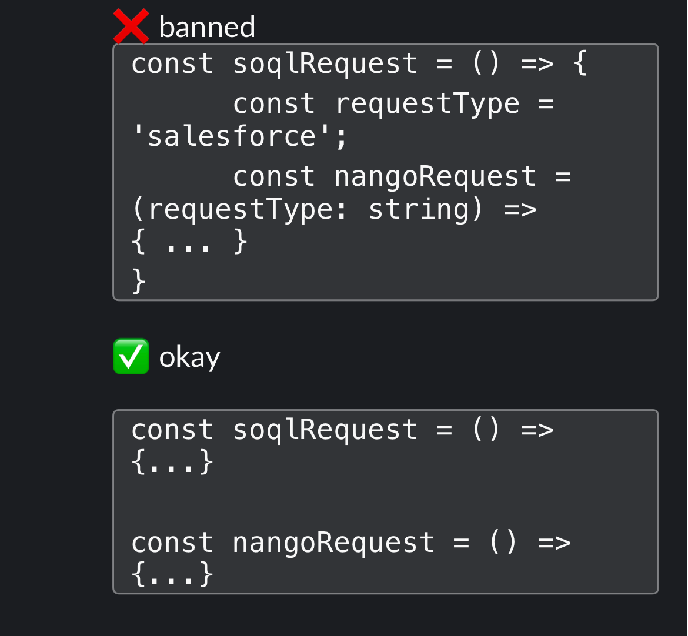

# Agent rules

Rules for any agent (or person) changing this repo. They apply to new and changed code; do not
rewrite unrelated files just to satisfy them. Detailed React rules live in
[`skills/frontend-developer.md`](skills/frontend-developer.md).

## Do not nest functions inside functions

Declare functions at module level and pass what they need as parameters. A function declared
inside another function hides its inputs, cannot be tested or reused on its own, is re-created on
every call, and makes the outer function long and hard to review.



Banned:

```ts
const loadTiers = () => {
  const format = 'sf'
  const scoreRow = (row: Row) => { ... } // hidden dependency on `format`
  return rows.map(scoreRow)
}
```

Okay:

```ts
const scoreRow = (row: Row, format: TierFormat) => { ... }

const loadTiers = (rows: Row[], format: TierFormat) =>
  rows.map((row) => scoreRow(row, format))
```

- **Banned:** a named function, `const fn = () => {}`, or component declared inside another
  function or component body, including helpers "only used once".
- **Allowed:** short anonymous callbacks passed directly as an argument (`map`, `filter`, `sort`,
  `reduce`, `setState((prev) => ...)`, an `onClick={() => ...}` that only calls another function).
  If a callback needs a name or more than a few lines, move it to module level.
- **Components:** never define a component inside another component (it remounts on every render).
  Hoist it and pass props.
- **Hooks:** a custom hook may contain callbacks it hands to `useCallback`/`useEffect`; extract any
  other logic into a plain top-level function the hook calls.
- If a function needs several values from its surroundings, that is a sign it wants its own
  parameters or a small object argument, not a closure.

## Pull requests include images for visible changes

Any PR that changes what a user sees must show it: add before/after screenshots (or a short
recording) to the PR description. Say which viewport and state they show, for example logged in on
a dynasty league at desktop width. If you could not capture one, say so in the PR instead of
omitting the section.

## Before opening a PR

- `npm test` and `npx tsc --noEmit -p .` pass from `firstballot/`.
- The PR states what was verified and what was not.
