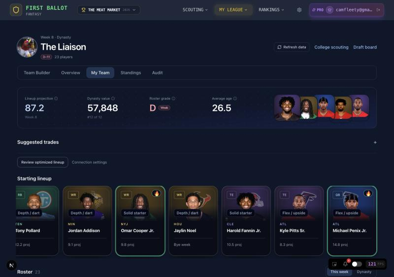
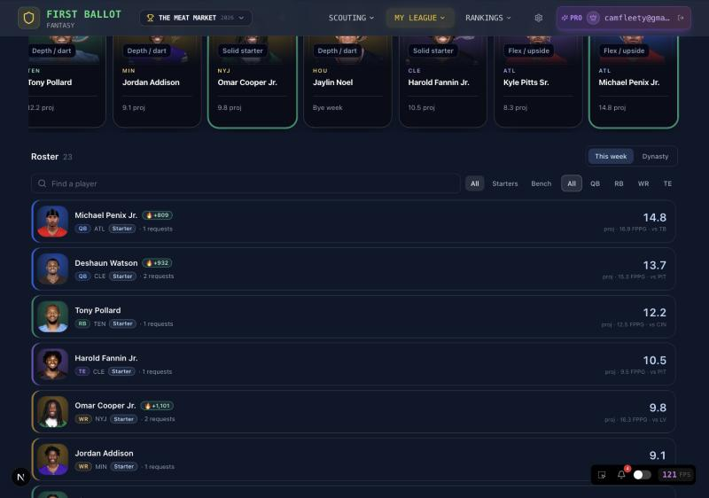
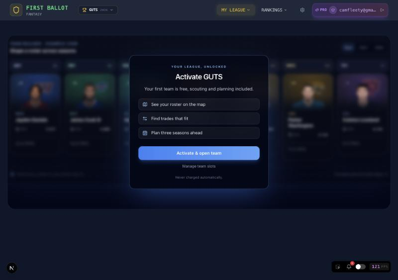
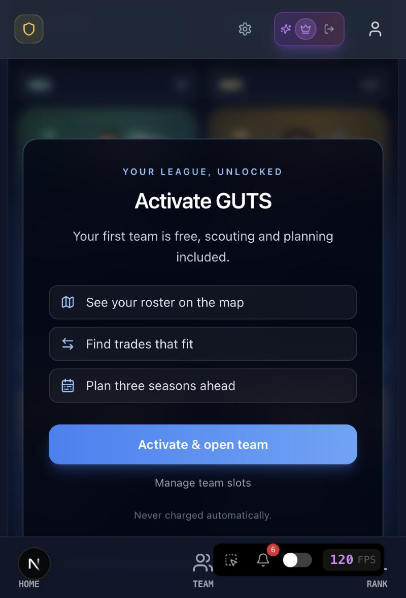

# UI updates

Screenshots of shipped UI changes. Add new entries at the top. See `AGENTS.md`: PRs that change
what a user sees include images.

All captured on production, signed in, desktop width (1440x900), The Meat Market league, 2027 view.

## My Team redesign (hero, starting lineup rail, headshot rows)
One badge system (position hue, tier gold/green/rose, 🔥/❄️ at +/-500 KTC), a hero band with the roster's
highest-value faces, the starting lineup as the same cards used on the map, and slim headshot-first rows.
Captured on localhost against production data, The Meat Market league, 1280x900.

## Activate team screen
A glass call-to-action over a blurred preview of the real Team Builder, with three reasons to activate.

## Team Builder: map-first layout, team strip, tier tags, hot markers
The page header now has **Refresh data**. A slim strip pinned to the top of the map shows team
state, core age, record, picks and 2027 pick chips. Cards carry a tier tag at the bottom-left
(opposite the position rank) and a 🔥 badge in the top-right with a green border for players up
500+ KTC in 30 days. Each card has an "Include in a trade" checkbox.

## Pick chips: tooltip
Hovering a pick chip shows the app-styled tooltip (slate panel, arrow) instead of the browser's
native one.

## Pick panel: assign a prospect
Clicking a pick opens a panel to search that draft class and pair a prospect with the pick.

## Pick panel: trade ideas
Players near the pick's KTC benchmark, each with "Review & send".

## Multi-select players for trade opportunities
Tick "Include in a trade" on several cards; a bar appears with "See trade opportunities".

The drawer shows ideas for the combined KTC value of the selected players.

## Landing: Team Builder preview shows player photos
Each example card loads a real headshot through `/api/player-image` (cached, resized).

_Logged out._

## Not captured
- "Consider trading" panel: no player on this roster currently meets a trade-signal rule.
- My Team roster table.
